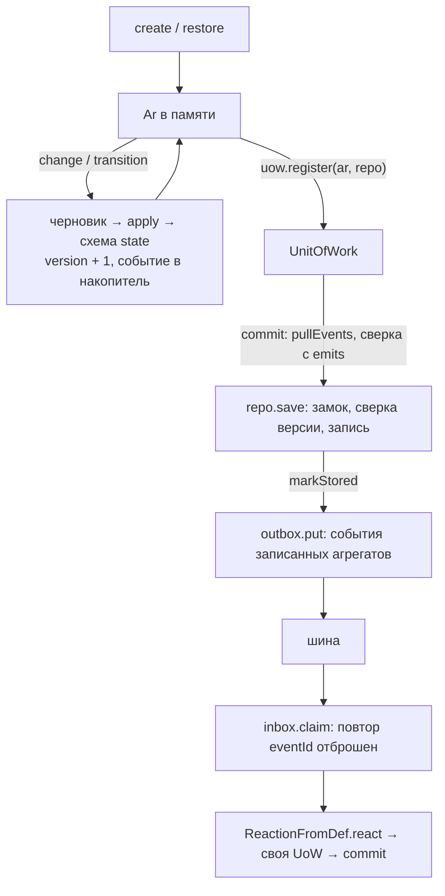

---
covers:
  - src/domain/aggregate/aggregate.ts
  - src/app/uow/**
  - src/app/events/**
  - src/app/reaction/reaction-from-def.ts
---

# Жизненный цикл агрегата и событий

**Назначение:** как изменение агрегата становится записью в хранилище и событием для других модулей — от `create`/`restore` до реакции подписчика, и что остаётся после сбоя на каждом шаге. Читать при работе с Ar, репозиторием, реакциями и при правке UoW или outbox.

---

## Схема

## Как это работает

1. **Рождение.** `create` строит state через `newState` (версия 0) и обычно записывает событие о создании; `restore` поднимает агрегат из записи. Агрегат помнит, с какой версией загружен (`storedVersion`); у созданного её нет.
2. **Изменение.** Метод Ar меняет черновик в `change` или `transition`: переход статуса берётся из Def, новое состояние проверяется схемой, версия растёт на 1, событие копится в агрегате. `Err` — черновик и события отброшены; невалидное состояние — исключение, в памяти его не бывает.
3. **Регистрация.** UC, ER или Job отдаёт агрегат в UoW с его репозиторием. UoW сверяет его с Def: агрегат своего модуля, у ER и Job — ещё и из `touches` или `scans`. Расхождение — баг реализации: в test и development исключение, в production — `warn` в лог, операция завершается.
4. **Фиксация.** `commit` забирает события и сверяет их с `emits` до записи, затем пишет агрегаты по порядку регистрации. Репозиторий под замком сверяет версию в хранилище с `storedVersion`: не совпала — `VERSION_CONFLICT`. После записи агрегата UoW сравнивает его состояние при загрузке (`baselineState`) с текущим и кладёт патч `changes` в `writes` для лога операций ([oplog.md](../reference/oplog.md)); затем база сдвигается на записанное (`markStored`).
5. **Публикация.** События уходят в outbox одной партией и только от записанных агрегатов. Outbox по умолчанию сразу публикует их в шину процесса.
6. **Доставка.** Реакция занимает доставку в inbox по паре «реакция, `eventId`»: повтор того же события отбрасывается. Реакция работает от имени `SystemCaller` без человека, со своей UoW; после отказа или исключения доставка снимается, и повтор исполнится снова. Сбой inbox наружу не выходит: не удалось занять доставку — `SERVER_INTERNAL` без исполнения, доставка не снимается (занята ли она, неизвестно); не удалось снять — результат как есть, сбой — в логгер.

**После сбоя.** Отката нет: если упала запись N-го агрегата, записанные до него остаются, их события уходят, а события N-го и следующих — нет. Сбой outbox после записи — исключение: данные записаны, события не считаются опубликованными. Упали и запись, и outbox — пробрасывается исключение записи со сбоем outbox в `cause`; `cause` занят или исключение не `Error` — `AggregateError` с обоими. Конфликт версии на N-м агрегате — `Err(VERSION_CONFLICT)`, но записанное до него тоже остаётся: повтор команды (D-56 его не отсеивает) исполнит её заново, и события записанных уйдут второй раз с новыми `eventId` — такой повтор отсеивает домен (D-47).

Образцы: [task.ar.ts](../../src/testing/example/todo/task/task.ar.ts), [task.json-repo.ts](../../src/testing/example/app/todo/infra/task.json-repo.ts), [release-removed-user-tasks.er.ts](../../src/testing/example/app/todo/task/er/release-removed-user-tasks.er.ts).

## Почему так

- Состояние меняет только Ar, наружу — `view()`, хранилищу — `snapshot()`: правило живёт в одном месте (D-05, D-44).
- UoW в платформе, а не в UC: реализация не публикует события незаписанного агрегата (D-15).
- Оптимистичная блокировка по версии: параллельная запись не затирает чужое изменение (D-36).
- Outbox и inbox: транспорт событий можно заменить персистентным, не меняя UC и реакции; повтор доставки не исполняет реакцию дважды (D-47).
- Время — аргумент операции: домен не читает часы и детерминирован в тестах (D-34).

## Где дальше

- Написать Ar — [guides/aggregate.md](../guides/aggregate.md), события — [guides/events.md](../guides/events.md), реакцию — [guides/event-reaction.md](../guides/event-reaction.md), репозиторий — [guides/repo.md](../guides/repo.md).
- Что вызывает UoW — [путь вызова UC](./uc-path.md).
