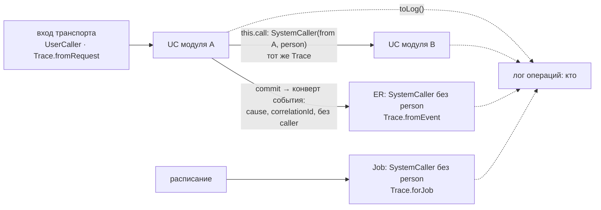

---
covers:
  - src/kernel/caller/**
  - src/kernel/trace/**
  - src/app/operation/**
  - src/app/oplog/**
  - src/app/events/event-envelope.ts
verified: b57c858
---

# Кто вызывает и откуда пришла операция

**Назначение:** как платформа отвечает на три вопроса об операции — от чьего имени она идёт, кто её физически вызвал и из-за чего она случилась, — и как ответы переживают вложенные вызовы, события и Job. Читать перед работой с Policy, межмодульными вызовами, аудитом и адаптерами входа.

---

## Схема

## Как это работает

1. **Три вопроса — три объекта.** *От чьего имени* — `caller.subject()`: его видят Policy и домен. *Кто физически* — `caller.person()` и форма `toLog()`: её видит аудит. *Из-за чего* — `Trace`: запрос, событие или прогон Job, а также `correlationId` всей цепочки.
2. **Субъект и исполнитель.** Обычно это один человек. При делегировании заместитель действует от имени того, кого замещает: Policy проверяет права замещаемого, а лог операций помнит обоих. Действия субъекта в логе находит `dmg-core oplog <dir> --subject <id>`, действия заместителя — `--actor <id>` ([oplog.md](../reference/oplog.md)). Это не «вход под чужим именем»: делегирование ограничено сроком и правами, отзывается и видно в аудите. Делегирование — агрегат приложения; платформа даёт вид `delegate`: для `callers` заместитель — `user`, сужения — «только лично» (`personal` у UC) и «только чтение» (`readOnly` у заместителя). На входе резолвер приложения проверяет заявку (`DelegationCheck`) на каждом запросе: отказ — ошибка, а не вход «как сам себе».
3. **Вложенный вызов.** UC модуля A вызывает UC модуля B через `this.call`: база подставляет `SystemCaller` с указанием, какая операция вызвала, и с исходным человеком. Поэтому B проверяет права того же субъекта, а матрёшки «система от имени системы» не бывает.
4. **Событие не несёт вызывающего.** Реакция работает не от имени человека, изменившего агрегат: она — следствие факта, а не его продолжение. Связь с причиной хранит след (`cause`, `correlationId`), а «кто изменил» — запись операции-причины в логе.
5. **Job — система, а не гость.** Гость — реальный посетитель без регистрации; у Job субъекта нет, поэтому системные UC без субъекта разрешаются явно (`callers: ['system']`, `allowAll`), а не молчаливым пропуском Policy.
6. **Вход решает один раз.** Адаптер строит `Caller` и `Trace` из своих данных (пользователь канала, токен) и дальше передаёт их неизменными; UC не узнаёт, бот это, HTTP или CLI.

Образцы: межмодульный вызов — [assign-task.uc.ts](../../src/testing/example/backend/todo/task/uc/assign-task.uc.ts), реакция — [release-removed-user-tasks.er.ts](../../src/testing/example/backend/todo/task/er/release-removed-user-tasks.er.ts).

## Почему так

- Четыре вида вызывающего, домен видит только субъекта: правила доступа не ветвятся по каналу (D-25).
- Заместитель для допуска — `user`, его сужения и проверка заявки — на краю платформы, а не в Policy (D-89).
- Вызывающий — классы с `subject()`, `person()`, `toLog()`, без отдельного вида `module`: межмодульный и внутренний системный вызов — один `SystemCaller` (D-43).
- `Caller` и `Trace` переходят границу процесса как JSON — модуль выносится в сервис без потери субъекта и следа (D-46).
- Присланный клиентом `requestId` в следе — ещё и ключ отсева повторов (D-56).

## Где дальше

- Классы, правила `callers` и Policy, поля `Trace` — [reference/caller.md](../reference/caller.md).
- Вызов чужого модуля — [guides/facade.md](../guides/facade.md); Policy — [guides/policy.md](../guides/policy.md).
- Где строятся `Caller` и `Trace` на входе — [как команда пересекает границу](./transport.md).
- Как подключить делегирование в приложении — [guides/delegation.md](../guides/delegation.md).
