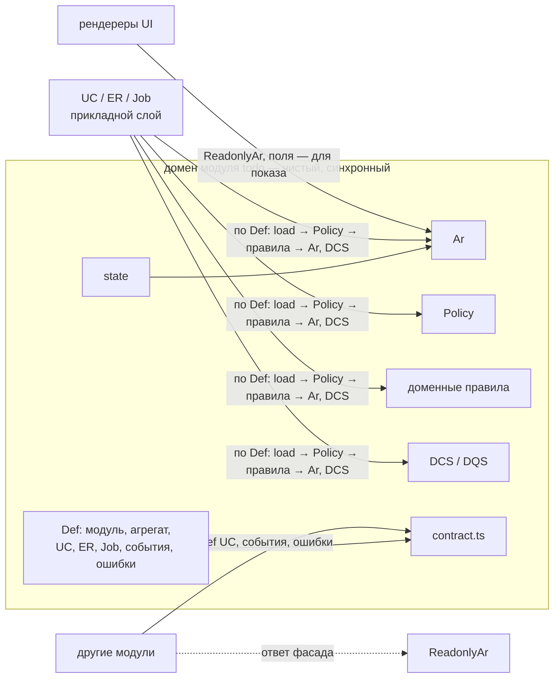

---
covers:
  - src/domain/**
  - src/kernel/def/**
  - src/kernel/result/**
  - src/testing/example/todo/**
verified: 26822fa
---

# Домен — приложение без инфраструктуры

**Назначение:** что такое домен в DMG и почему UC, реакции и UI не принимают решений. Читать перед первым модулем и всякий раз, когда хочется написать `if` по статусу вне Ar.

---

## Схема

## Как это работает

Домен — целое приложение: он полностью описывает предметную область и её правила. Где и как он запущен — хранилище, транспорт, часы, процесс, асинхронность — он не знает. Поэтому один домен работает под ботом, HTTP, CLI или в отдельном сервисе, а его тесты идут без репозиториев и шины.

| Объект | Зачем | Где живёт | Кто использует снаружи |
|---|---|---|---|
| Def | контракт: что умеет модуль, какие данные, какие отказы и события | `<domain>/<m>/<a>/…`, `<m>.module.ts` | прикладной слой, граф, транспорт, генератор |
| state | форма данных агрегата | `<a>.state.ts` | только Ar, Def своего модуля, репозиторий |
| Ar | инварианты, переходы, вопросы к одному агрегату | `<a>.ar.ts` | UC, ER, Job; снаружи — `ReadonlyAr` |
| Policy | право субъекта на действие | `<a>.policy.ts` | конвейер UC |
| доменные правила | допустимо ли действие при текущих состояниях, без субъекта | `<a>.rules.ts` | конвейер UC |
| DCS / DQS | решение над несколькими агрегатами: с мутацией / на чтение | `<m>/<topic>.dcs.ts`, `.dqs.ts` | UC, ER, Job |
| события, ошибки | факты и отказы как значения | `<a>.events.ts`, `<a>.errors.ts` | реакции, вызывающие, клиенты |
| `contract.ts` | вход модуля для остального кода | `<m>/contract.ts` | другие модули, адаптеры, скрипты |
| `AppDef` | приложение: полный состав модулей и его тексты; размещения, раскладки и версии нет | `<domain>/<имя>.app.ts` | граф (корень приложения), `arch:check`, генератор (`gen module` дописывает модуль) |

1. **Решает только домен.** UC знает порядок шагов, но не правила: «можно ли завершить задачу» отвечает Ar, «может ли этот человек» — Policy, «активен ли исполнитель» — доменное правило. Прикладной слой собирает данные, зовёт домен и отдаёт результат на запись.
2. **Чистый и синхронный.** Методы домена получают всё нужное аргументами и возвращают `Result` или ответ на вопрос. Ни один не читает диск, сеть или часы. Единственная асинхронность — `Loader<T>`, который DCS или DQS может получить для условной или дорогой загрузки: что и откуда грузить, решает вызывающий, а не домен.
3. **Тот же код — на клиенте.** Клиент получает снапшот, собирает `ReadonlyAr` и задаёт ему те же вопросы, что сервер, — правило не дублируется в UI.
4. **Граница модуля — контракт.** Другие модули видят Def UC, события и ошибки, а агрегаты чужого модуля — только `ReadonlyAr` из ответа фасада.

**Что в домен не входит** и где живёт вместо этого:

| Вне домена | Где |
|---|---|
| текущее время | аргумент операции (`complete(at)`); часы — порт приложения |
| запись и публикация событий | UoW прикладного слоя после `Ok` |
| вызов другого модуля | шаг `fetch` UC, фасад модуля-владельца |
| транспорт, `Caller`, `Trace` | адаптеры входа и приложение; домен видит только субъекта |
| окружение (`process.env`, конфиг) | раннер, `AppEnv` |

Образец — модуль [todo](../../src/testing/example/todo/contract.ts); доказательство «без инфраструктуры» — его доменные тесты, например [task.ar.test.ts](../../src/testing/example/todo/task/task.ar.test.ts) и [task.rules.test.ts](../../src/testing/example/todo/task/task.rules.test.ts): ни репозитория, ни шины, ни часов.

## Почему так

- Решения по полям принимает только Ar, остальные видят его методы: правило живёт в одном месте (D-05, D-39).
- Уровни API — Ar, Policy, DCS/DQS: у каждого вопроса один ответчик (D-06).
- `ReadonlyAr` и изоморфный домен: клиент пользуется теми же правилами, что сервер (D-07).
- Право субъекта и допустимость действия разведены: Policy не разбирает чужие данные (D-40).
- Время — аргумент: домен детерминирован в тестах (D-34).
- Вход модуля — `contract`, state — внутри: модуль меняет данные, не ломая соседей (D-45), и готов к выносу в сервис (D-28).
- Состав приложения — манифест `AppDef`: у приложения есть тексты и место в графе, а конфиг проверок берёт манифест, а не копию его фактов (D-93).

## Где дальше

- Куда направлены зависимости между слоями — [слои и зависимости](./layers.md); в каком порядке открывать файлы — [как читать модуль](./reading-a-module.md).
- Написать Ar — [guides/aggregate.md](../guides/aggregate.md), Policy — [guides/policy.md](../guides/policy.md), state — [guides/state.md](../guides/state.md).
- Куда поместить правило, кейс назначения задачи — [куда поместить правило](./rule-placement.md); правила размещения — [reference/domain-modeling.md](../reference/domain-modeling.md).
