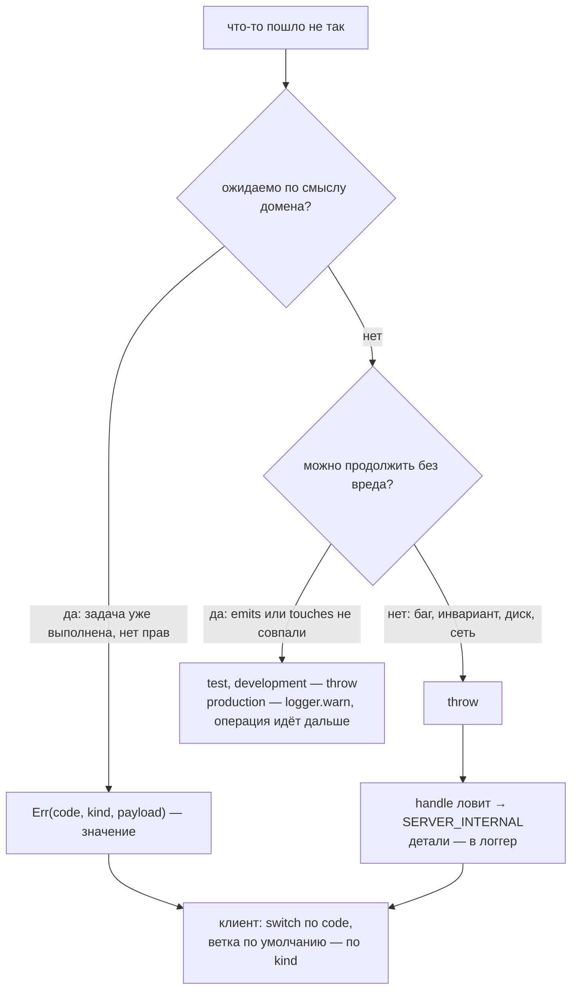

---
covers:
  - src/kernel/errors/**
  - src/kernel/result/**
  - src/app/use-case/use-case-from-def.ts
verified: d20edbc
---

# Отказ, баг и сбой

**Назначение:** как платформа различает «операция не разрешена по смыслу», «код написан неверно» и «упал диск», и что в каждом случае видят клиент, лог и следующий шаг конвейера. Читать перед первым Ar или UC и при выборе между `Err`, `throw` и `warn`.

---

## Схема

## Как это работает

1. **Отказ — значение.** Метод Ar, DCS, фасад и UC возвращают `Result`: тип ошибки — union объявленных кодов. Вызывающий не может «забыть» отказ: без проверки `ok` до значения не добраться, а `switch` по `code` компилятор сверяет с объявленными. Отказ ничего не меняет — черновик Ar отброшен, UoW не фиксируется.
2. **Ошибка — Def, а не строка.** Код, `kind`, тексты и схема payload объявлены в `ErrorDef` агрегата; UC и фасад ссылаются на них. Поэтому список отказов UC виден в контракте (`OPTIONS`, граф) и проверяется: вернуть необъявленную ошибку не даст компилятор.
3. **`kind` — для общего.** Код — для конкретной ветки, `kind` — для всего остального: ветки по умолчанию в UI, уровня лога, алерта на `internal`, HTTP-статуса в адаптере. Сама ошибка транспорт не знает.
4. **Исключение — только когда продолжать нельзя.** Баг, повреждённые данные, сбой хранилища бросаются. Конвейер UC ловит их на границе: клиент получает `SERVER_INTERNAL` без деталей, логгер — всё; процесс не падает, данные не фиксируются.
5. **Нарушение контракта без вреда — громко в разработке, тихо в бою.** Расхождение реализации с Def (событие вне `emits`, агрегат вне `touches`) — баг, но ронять из-за него операцию пользователя в production хуже, чем дописать предупреждение. В тестах это исключение, поэтому баг не доживает до релиза.
6. **Выход — тоже контракт.** Невалидный выход UC — баг реализации: операция отказывает целиком до фиксации, клиент безопасно повторяет. Частичный ответ сломал бы клиента и мог раскрыть лишние поля.

Образцы: [task.errors.ts](../../src/testing/example/todo/task/task.errors.ts), отказы UC по конкретному `code` — [complete-task.uc.test.ts](../../src/testing/example/app/todo/task/uc/complete-task.uc.test.ts).

## Почему так

- `Result` вместо `throw` для штатных отказов: отказ — часть контракта, его видят типы и документация (D-13).
- Нет отката записи нескольких агрегатов: после отказа на N-м записанные остаются, поэтому UC по возможности меняет один агрегат (D-15).
- Конфликт версий — отказ `conflict`, а не исключение: клиент повторяет с актуальными данными (D-36).
- Тексты ошибки не едут по проводу: клиент берёт их из того же Def (D-49).

## Где дальше

- Объявить ошибки агрегата — [guides/errors.md](../guides/errors.md).
- Модель ошибки, базовые ошибки ядра, гарантии `handle` — [reference/errors-result.md](../reference/errors-result.md); правило ERR-07 — [rules.md](../reference/rules.md).
- Порядок шагов конвейера — [путь вызова UC](./uc-path.md); что остаётся после сбоя записи — [жизненный цикл агрегата](./aggregate-lifecycle.md).
