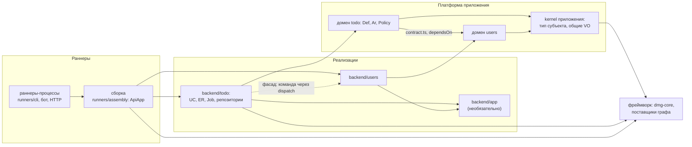

---
covers:
  - src/arch/**
  - src/app/api-app/api-app.ts
  - src/app/facade/**
  - src/domain/contracts/module-def*.ts
verified: 269f105
---

# Слои и зависимости

**Назначение:** почему код приложения на DMG разложен по четырём осям, куда направлены зависимости, как модули общаются, не импортируя друг друга, и ради каких сценариев роста всё это устроено. Читать перед первым модулем и когда непонятно, где разместить код или почему импорт запрещён.

---

## Схема

Зависимости направлены в одну сторону: раннеры → реализации → `backend/app` → домен → `kernel` → фреймворк. Кто что видит — таблица [layers.md](../reference/layers.md) §2.

## Как это работает

1. **Фреймворк** — `dmg-core` и поставщики графа: пакеты npm, не каталоги проекта. Даёт Def-классы, базовые классы исполнения, граф и проверки.
2. **Платформа приложения** — то, что едино при любом способе запуска: `kernel` приложения и домен. Домен — чистый и синхронный: Def, Ar, Policy, доменные правила, DCS/DQS; он не знает ни хранилища, ни транспорта. `kernel` — фундамент под доменом: простой тип субъекта и роли, общие поля и VO, чистые помощники; домен импортирует `kernel`, не наоборот. Из платформы приложения строится граф: контракты и манифесты полны без реализаций.
3. **Реализации** — пакет реализации модуля `backend/<m>`, один на модуль домена: UC, ER и Job по Def, репозитории, фабрика модуля (его содержимое — прикладной слой). Фреймворк даёт базовые классы, поэтому здесь только оркестрация. Общее для всех реализаций, которому нужен домен (например, базовый UC с закрытым субъектом), — необязательный пакет `backend/app`; каталога нет — слоя нет.
4. **Раннеры** — что, где и на чём запущено. Сборка `runners/assembly` — корень сборки: строит контекст, хранилища, модули через `ApiApp` (фасады по `dependsOn`, цикл — исключение) и резолвер `Caller`. Раннеры-процессы (CLI, бот, HTTP) превращают внешний запрос в команду и `Caller` и вызывают сборку; пакеты реализаций они не видят — иначе транспорт достал бы репозиторий мимо UC. На события раннер подписывается через `EventSubscriber` из контекста сборки.
5. **Между модулями.** Чужой модуль виден только через его `contract.ts` и только если он в `dependsOn`. Вызов идёт командой через фасад, а не импортом реализации; ответ — `ReadonlyAr`, без мутаций. Нижестоящий модуль вышестоящий не вызывает: нижестоящий публикует событие, вышестоящий подписывается реакцией — граф `dependsOn` остаётся ациклическим.
6. **Слои — данные, проверяющий один.** Каждый слой объявлен данными: имя, ось, каталоги, кого видит и через какой вход. Слои фреймворка берут каталоги из `GenLayout` (секция `gen` в `dmg-core.json`); поставщик графа объявляет свои слои тем же типом, каталоги им задаёт проект в `ArchApp.layers`. Все импорты между каталогами проекта проверяет один проверяющий слоёв в `arch:check` (ARC-02/04/06/07/08, TST-07; слои поставщиков — [ARC-13](../reference/rules.md)); пакеты npm — линтер (ARC-02).
7. **Единица выноса** — в профиле `monorepo` пакет `workspaces`. `arch:check` держит границу единиц: каждый импортируемый пакет объявлен в её `package.json` (ARC-14), между единицами — только имя пакета и вход из `exports` (ARC-15), граф строится из платформы приложения без реализаций и раннеров (ARC-16). В `single` единиц нет: те же оси папками, проверки единиц молчат.
8. **Прочие проверки** `arch:check`: состав `AppDef` (MAN-15), граф Def, файлы модулей 1:1 с Def, правила поставщиков графа. Конфиг проверок `ArchApp` собирается из входа графа: поставщик, добавленный в граф, попадает и в `arch:check`. Рядом в `dmg-core/arch` — `DebtChecker`: реестры долга сверены с кодом (ARC-12).

Образец: [example.arch.ts](../../src/testing/example/example.arch.ts) — учебное приложение в форме `single`, модули `todo` и `users`, `todo` зависит от `users`; слой поставщика `screen` с подпиской и правилом графа — [screen-provider.ts](../../src/testing/example/screen/screen-provider.ts), [screen.arch.ts](../../src/testing/example/screen.arch.ts).

## Сценарии роста

**Сценарии предусмотрены решениями и раскладкой, но вживую не проверены.** Машина проверяет только структуру — слои, границы пакетов, объявленные зависимости. Сам вынос пакет не исполняет: нет прогона копии пакета вне монорепо, шва исполнения удалённого модуля, второго процесса в тестах (D-109). Проверка и правка пакета — при первом реальном выносе; что тогда пишется руками — [extract-module.md](../guides/extract-module.md).

Сценарий — устойчивый ID случая, ради которого существует усложнение: решение, которое добавляет пакет, слой или запрет, ссылается на сценарий из этой таблицы (D-109). Статус: «предусмотрен» — обеспечен решениями и раскладкой; «проверен вживую: <проект>, <дата>».

| ID | Сценарий | Что требует | Статус |
|---|---|---|---|
| GR-01 | Модуль выносится в сервис: его реализация работает в другом процессе или на другом сервере | реализации не видят друг друга, сборку и раннеры; раннер-процесс не видит реализации; у пакета реализации объявлены все зависимости и нет относительных путей к соседям; сервис объявляет свою сборку и хранилище; вызов — командой по контракту, на границе JSON | предусмотрен |
| GR-02 | Реализация модуля пишется на другом языке по тем же манифестам | граф и контракты строятся из платформы приложения без реализаций; `kernel` и домен не видят реализаций; общий тип субъекта и VO — в платформе приложения, а не в сборке | предусмотрен |

## Почему так

Правило → сценарий → решение:

- Платформа приложения отдельно от реализаций, сборка — в раннерах → GR-01, GR-02 → D-106.
- `kernel` под доменом, а не в сборке: общий тип субъекта и VO нужны и вынесенному модулю, и реализации на другом языке → GR-01, GR-02 → D-106.
- Раннер-процесс видит сборку, а не реализации (ARC-08); реализации не видят друг друга и сборку (ARC-06) → GR-01 → D-106, D-52.
- Слои — данные, один проверяющий на все слои, в том числе поставщиков, и слой поставщика не связан с реализациями → GR-01 → D-107.
- `kernel` и домен не видят реализаций по пути (ARC-02) → GR-02 → D-107.
- Единица выноса — пакет `workspaces`: объявленные зависимости и граница пакета (ARC-14, ARC-15) → GR-01 → D-108.
- Граф из платформы приложения (ARC-16) → GR-02 → D-108.
- Граница модуля — Def и команда, а не общие объекты в памяти: фасады асинхронны, на границе JSON → GR-01 → D-28, D-49.
- Вход модуля для чужого кода — только `contract`; state, DCS и ArDef остаются внутри (D-45). Ar, Policy и DQS контракт отдаёт по нужде зависимых, чужой код видит Ar только для чтения (D-69).
- Решения по полям принимает только Ar, остальные видят его методы: правило не расползается по слоям (D-05, D-39).
- Раскладку фасадов делает `ApiApp`, корень сборки — раннеры: модуль получает зависимости, но не собирает их сам (D-50, D-106).

## Где дальше

- Что куда импортировать — [layers.md](../reference/layers.md); где разместить доменную логику — [domain-modeling.md](../reference/domain-modeling.md).
- Собрать приложение — [guides/app.md](../guides/app.md); раскладка проекта — [guides/project.md](../guides/project.md); вынести модуль в сервис — [guides/extract-module.md](../guides/extract-module.md).
- Вызвать другой модуль — [guides/facade.md](../guides/facade.md); как один вызов проходит через слои — [путь вызова UC](./uc-path.md).
