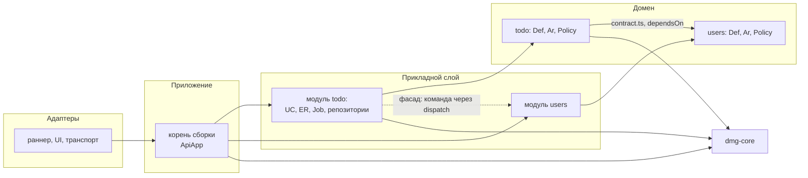

---
covers:
  - src/arch/**
  - src/app/api-app/api-app.ts
  - src/app/facade/**
  - src/domain/contracts/module-def*.ts
verified: 9994ad8
---

# Слои и зависимости

**Назначение:** почему код приложения на DMG разложен по четырём осям, куда направлены зависимости и как модули общаются, не импортируя друг друга. Читать перед первым модулем и когда непонятно, где разместить код или почему импорт запрещён.

---

## Схема

## Как это работает

1. **Домен** — чистый и синхронный: Def, Ar, Policy, доменные правила, DCS/DQS. Он не знает ни хранилища, ни транспорта: из платформы — только корень `dmg-core`.
2. **Прикладной слой** — один пакет на модуль домена: реализует UC, ER и Job по Def, хранит агрегаты, собирает модуль. Платформа даёт базовые классы, поэтому здесь только оркестрация.
3. **Приложение** — корень сборки: строит контекст, репозитории и модули, раскладывает фасады по `dependsOn`. Модули собираются в порядке зависимостей, цикл — исключение сборки.
4. **Адаптеры** — раннер, UI, транспорты: превращают внешний запрос в команду и `Caller`, вызывают приложение.
5. **Между модулями.** Чужой модуль виден только через его `contract.ts` и только если он в `dependsOn`. Вызов идёт командой через фасад, а не импортом реализации; ответ — `ReadonlyAr`, без мутаций. Нижестоящий модуль вышестоящий не вызывает: если тому нужна реакция, нижестоящий публикует событие, а вышестоящий подписывается реакцией — подписчик зависит от публикатора, и граф `dependsOn` остаётся ациклическим.
6. **Проверка.** Направления импортов и связи модулей проверяют линтер и `ArchChecker` (`arch:check`: граф Def, файлы модулей, импорты корня сборки и раннеров), а не ревью. Рядом в `dmg-core/arch` — `DebtChecker`: реестры долга сверены с кодом — учёт отступлений ([ARC-12](../reference/rules.md)).

Образец: [example.arch.ts](../../src/testing/example/example.arch.ts) — модули `todo` и `users`, `todo` зависит от `users`.

## Почему так

- Модуль готов к выносу в сервис: его граница — Def и команда, а не общие объекты в памяти (D-28, D-49).
- Вход модуля для остального кода — только `contract`; state, DCS и ArDef остаются внутри (D-45). Ar, Policy и DQS контракт отдаёт по нужде зависимых, чужой код видит Ar только для чтения (D-69).
- Решения по полям принимает только Ar, остальные видят его методы: правило не расползается по слоям (D-05, D-39).
- Раскладку фасадов делает платформа, а корень сборки — приложение: модуль получает зависимости, но не собирает их сам (D-50).

## Где дальше

- Что куда импортировать — [layers.md](../reference/layers.md); где разместить доменную логику — [domain-modeling.md](../reference/domain-modeling.md).
- Собрать приложение — [guides/app.md](../guides/app.md); вызвать другой модуль — [guides/facade.md](../guides/facade.md).
- Как один вызов проходит через слои — [путь вызова UC](./uc-path.md).
