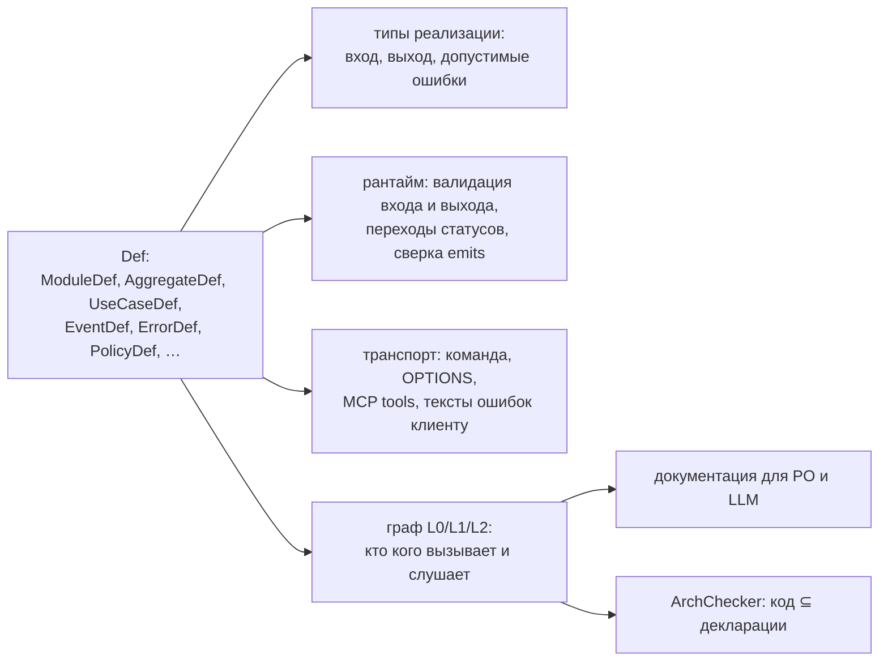

---
covers:
  - src/domain/contracts/**
  - src/domain/aggregate/aggregate-def.ts
  - src/domain/events/event-def.ts
  - src/kernel/errors/error-def.ts
  - src/kernel/def/**
  - src/graph/**
  - src/arch/**
verified: 51d7f89
---

# Манифест — один источник

**Назначение:** почему каждый агрегат, операция, событие и ошибка описаны объектом Def и что из этого описания получают типы, транспорт, документация и проверки. Читать перед первым Def и когда хочется продублировать в коде то, что уже объявлено.

---

## Схема

## Как это работает

1. **Объявить один раз.** Вход и выход UC, статусы и переходы агрегата, события и ошибки описаны в Def со схемами и текстами. Реализация наследует базовый класс по Def и не повторяет его свойства: схема входа, список ошибок и разрешённые переходы приходят из Def.
2. **Типы из Def.** Реализация UC может вернуть только объявленные ошибки; клиент по тому же Def собирает команду и получает типизированный ответ. Пропущенная реализация UC модуля — ошибка компиляции.
3. **Рантайм из Def.** Вход и выход проверяются схемами, переход статуса — по таблице `from`/`to`, отказ для статуса вне `from` берётся из `rejects`. Метод Ar пишет только суть операции.
4. **Связи — ссылками.** `on: UserEvents.removed`, `errors: [TaskErrors.ALREADY_DONE]`, `calls: [GetUserUcDef]`: имя, опечатку в котором заметит только рантайм, не пишется. Обратные связи («кто слушает это событие») не объявляются — их вычисляет граф.
5. **Граф — для людей и машин.** Из Def строится граф трёх уровней: карта модулей, модуль, агрегат. По нему каскад «UI → UC → агрегат → событие → реакция → …» прослеживается сквозь модули, а PO и LLM видят модель, а не список ручек.
6. **Декларация проверяется.** Что можно проверить типом — проверяет компилятор; что нельзя (`emits`, `touches`, `dependsOn`, описания, JSON Schema) — `ArchChecker` и рантайм-сверка в тестах. Def, расходящийся с кодом, не доживает до релиза.

Образцы: [task.ar.ts](../../src/testing/example/todo/task/task.ar.ts) (Def агрегата и переходы), [complete-task.uc.ts](../../src/testing/example/todo/task/uc/complete-task.uc.ts) (Def UC), [todo.module.ts](../../src/testing/example/todo/todo.module.ts) (паспорт модуля).

## Почему так

- Декларация плюс верификация: Def — не комментарий, его соблюдение проверяется (D-12).
- Жизненный цикл — только в Def: проверки статуса не дублируются в методах Ar (D-35).
- Def — классы с поведением вида, а не данные с `switch` по виду в чужом коде (D-48).
- Def — источник типов клиента, команда — исполнение (D-49).

## Где дальше

- Семейство Def, обязательные описания, схемы, таблица проверок — [reference/manifests.md](../reference/manifests.md).
- Написать Def — гайды [state](../guides/state.md), [aggregate](../guides/aggregate.md), [use-case](../guides/use-case.md), [events](../guides/events.md), [errors](../guides/errors.md).
