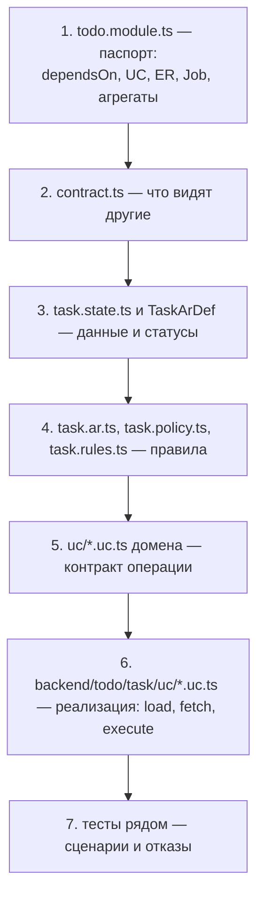

---
covers:
  - src/testing/example/platform/domain/todo/**
  - src/testing/example/backend/todo/**
  - src/gen/kinds/**
verified: 06429f5
---

# Как читать модуль

**Назначение:** в каком порядке открывать файлы незнакомого модуля DMG, чтобы за несколько минут понять, что он умеет, кто его вызывает и где живут правила. На примере модуля `todo` учебного пакета; раскладка у всех модулей одна — её создаёт генератор.

---

## Схема

## Как это работает

1. **Паспорт** — [todo.module.ts](../../src/testing/example/platform/domain/todo/todo.module.ts): от кого модуль зависит, какие операции и реакции у него есть. Это оглавление: всё остальное — расшифровка его строк.
2. **Контракт** — [contract.ts](../../src/testing/example/platform/domain/todo/contract.ts): Def UC, события и ошибки, которые видит остальной код, и Ar, Policy, правила — по нужде адаптеров (D-69, D-104), с пометкой «кто и зачем». Чего нет в контракте, снаружи не используют.
3. **Данные** — [task.state.ts](../../src/testing/example/platform/domain/todo/task/task.state.ts) и Def агрегата (`TaskArDef` в начале `task.ar.ts`): поля, статусы и разрешённые переходы с отказами. Жизненный цикл читается из Def, а не из кода методов.
4. **Правила** — [task.ar.ts](../../src/testing/example/platform/domain/todo/task/task.ar.ts) (операции и методы-вопросы), [task.policy.ts](../../src/testing/example/platform/domain/todo/task/task.policy.ts) (кто может), [task.rules.ts](../../src/testing/example/platform/domain/todo/task/task.rules.ts) (что допустимо при текущих состояниях). Решения модуля — только здесь и в DCS/DQS.
5. **Операции домена** — `platform/domain/todo/task/uc/*.uc.ts`: Def UC — вход, выход, ошибки, вызывающие, Policy, правила, события. Этого хватает, чтобы понять операцию без реализации.
6. **Реализация** — `backend/todo/task/uc/*.uc.ts`: что загружается, что спрашивается у других модулей, какой метод Ar вызывается. Ветвлений по полям здесь нет (API-01). Карта «Def → класс» — [backend/todo/todo.module.ts](../../src/testing/example/backend/todo/todo.module.ts).
7. **Тесты** рядом с файлами: именованные сценарии отказов и сбоев — самое точное описание поведения.

Файл, которого нет в этой раскладке, — сигнал: либо модуль отклонился от правил, либо это инфраструктура (`infra/`, репозитории).

## Почему так

- Def — единственное описание операции: из него выводятся типы, граф и транспорт, поэтому читать его быстрее и надёжнее кода (D-49).
- Контракт отделён от внутренностей модуля: читатель снаружи видит только то, на что может опереться (D-45).
- Правила — в домене, реализация — оркестрация: чтобы понять «почему отказ», не нужно читать прикладной слой (D-05).

## Где дальше

- Как модуль устроен по слоям — [слои и зависимости](./layers.md); путь одной команды — [путь вызова UC](./uc-path.md).
- Имена файлов и раскладка — [naming.md](../reference/naming.md); гайды по каждому файлу — [guides/](../guides/index.md).
