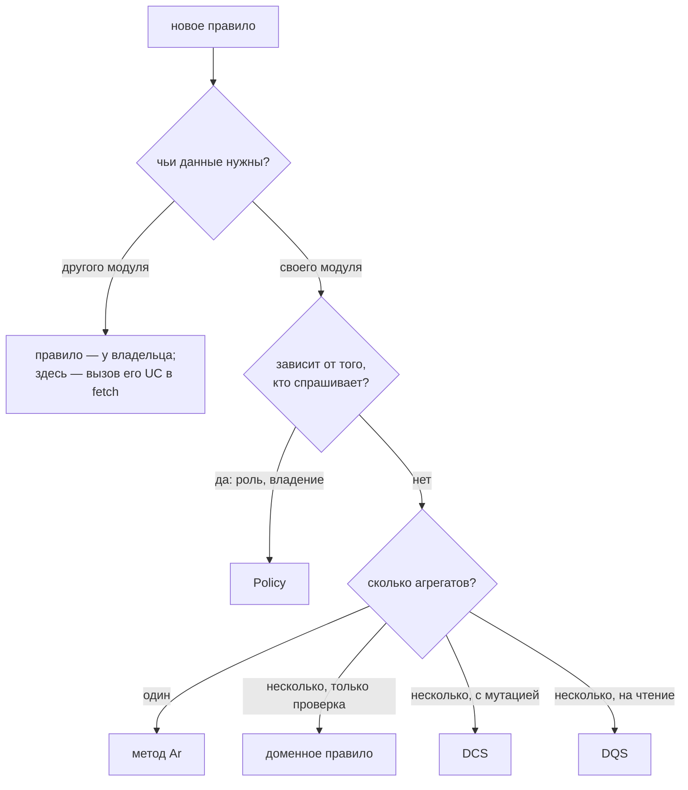

---
covers:
  - src/domain/policy/**
  - src/domain/rules/**
  - src/testing/example/todo/task/task.policy.ts
  - src/testing/example/todo/task/task.rules.ts
  - src/testing/example/todo/task/uc/assign-task.uc.ts
---

# Куда поместить правило

**Назначение:** как выбрать модуль и объект для нового доменного правила и почему «просто проверить в UC» или «добавить в Policy» обычно неверно. Читать, когда правило не ложится в один агрегат или касается чужого модуля.

---

## Схема

## Как это работает

1. **Сначала владелец.** Правило живёт там, где данные, на которые оно смотрит. Иначе один вопрос («активен ли пользователь») отвечают два модуля, и при изменении правила они расходятся.
2. **Затем субъект.** Policy отвечает только «может ли этот человек»: её ответ меняется от того, кто спрашивает. Ответ, одинаковый для всех («исполнитель неактивен»), — не право, а допустимость действия: доменное правило. Так отказ Policy всегда значит «не тебе», а отказ правила — «не сейчас».
3. **Затем масштаб.** Один агрегат — его метод: Ar знает своё состояние и не отдаёт поля. Несколько агрегатов — правило или сервис домена, которые получают агрегаты готовыми и спрашивают их методы.
4. **UC только собирает.** Загрузить, спросить Policy, получить ответ чужого модуля, передать его правилу, вызвать Ar — порядок, а не решение. Любой `if` по данным в UC — правило, которое уже никто не найдёт в домене и не проверит без инфраструктуры.

**Кейс: назначение задачи.** Назначить задачу можно только активному пользователю модуля `users`; назначает владелец задачи или администратор.

| Вариант | Почему нет |
|---|---|
| всё в `TaskPolicy`, она спрашивает `users` | знание о чужих данных утекло в право субъекта |
| `if (!user.active)` в `execute` UC | доменное решение в прикладном слое |
| активность исполнителя — правило Policy | ответ не зависит от того, кто назначает |

Итог: Policy `todo` — только `canManage` (владелец или администратор). UC в шаге `fetch`, после Policy, вызывает UC `users` и кладёт ответ в контекст; доменное правило `assigneeActive` решает о допуске. Отказ «пользователя нет» пробрасывается как есть — это факт `users`; «пользователь неактивен» переводится в ошибку `todo`: в задаче он значит «назначить нельзя».

Образцы: [task.policy.ts](../../src/testing/example/todo/task/task.policy.ts), [task.rules.ts](../../src/testing/example/todo/task/task.rules.ts), [assign-task.uc.ts](../../src/testing/example/todo/task/uc/assign-task.uc.ts).

## Почему так

- Решения по полям — только в Ar: правило не расползается по слоям (D-05, D-39).
- Право субъекта и допустимость действия разведены: Policy не разбирает чужие данные (D-40).
- Чужой модуль спрашивается после права: не-владелец не узнаёт его ответ (D-58).
- Межмодульная мутация видна в `calls`, а не спрятана в UC (D-42, D-43).

## Где дальше

- Правила размещения и антипаттерны — [reference/domain-modeling.md](../reference/domain-modeling.md).
- Написать Policy — [guides/policy.md](../guides/policy.md), Ar — [guides/aggregate.md](../guides/aggregate.md); что такое домен — [домен](./domain.md).
