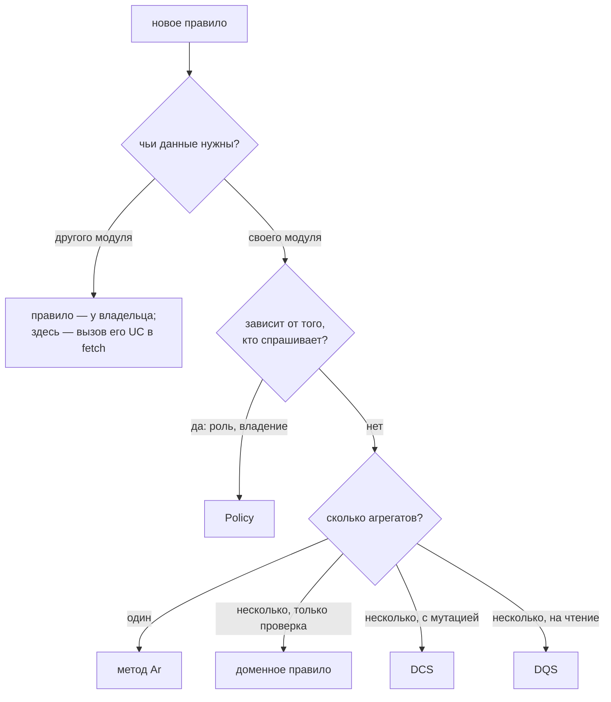
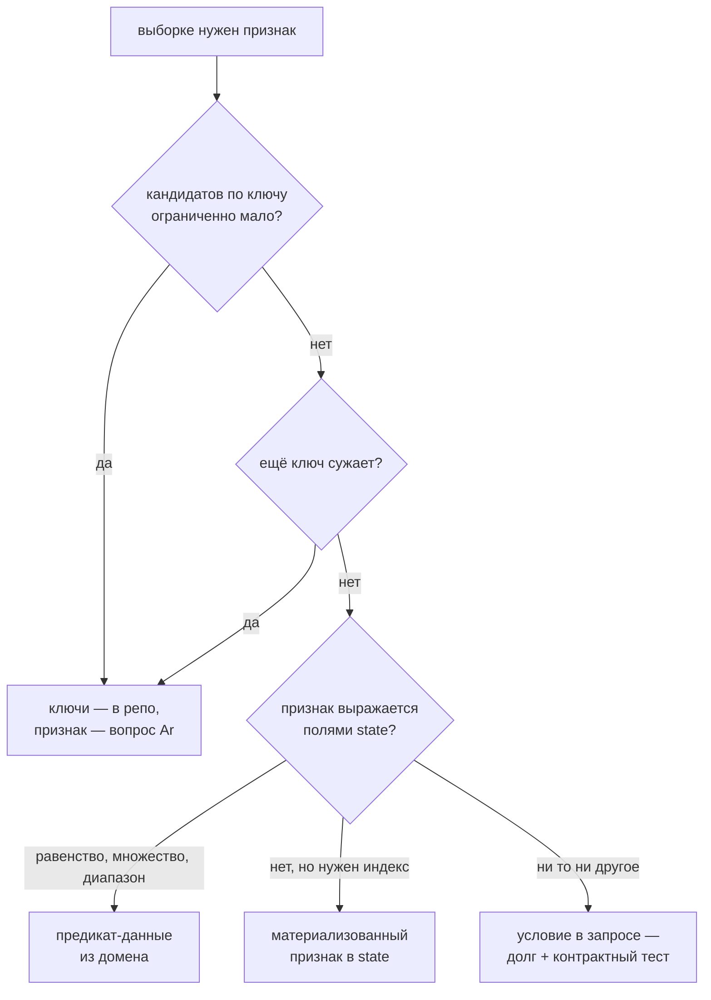

---
covers:
  - src/domain/policy/**
  - src/domain/rules/**
  - src/testing/example/todo/task/task.policy.ts
  - src/testing/example/todo/task/task.rules.ts
  - src/testing/example/todo/task/uc/assign-task.uc.ts
  - src/testing/example/app/todo/infra/task.json-repo.ts
verified: 26822fa
---

# Куда поместить правило

**Назначение:** как выбрать модуль и объект для нового доменного правила и почему «просто проверить в UC» или «добавить в Policy» обычно неверно; как выборка репозитория пользуется правилом, не повторяя его. Читать, когда правило не ложится в один агрегат, касается чужого модуля или нужно в запросе к хранилищу.

---

## Схема



## Как это работает

1. **Сначала владелец.** Правило живёт там, где данные, на которые оно смотрит. Иначе один вопрос («активен ли пользователь») отвечают два модуля, и при изменении правила они расходятся.
2. **Затем субъект.** Policy отвечает только «может ли этот человек»: её ответ меняется от того, кто спрашивает. Ответ, одинаковый для всех («исполнитель неактивен»), — не право, а допустимость действия: доменное правило. Так отказ Policy всегда значит «не тебе», а отказ правила — «не сейчас».
3. **Затем масштаб.** Один агрегат — его метод: Ar знает своё состояние и не отдаёт поля. Несколько агрегатов — правило или сервис домена, которые получают агрегаты готовыми и спрашивают их методы.
4. **UC только собирает.** Загрузить, спросить Policy, получить ответ чужого модуля, передать его правилу, вызвать Ar — порядок, а не решение. Любой `if` по данным в UC — правило, которое уже никто не найдёт в домене и не проверит без инфраструктуры.

5. **UI решает через домен или получает готовое.** Где UI возьмёт основание решения, проектируется для сценария: либо фронт получает агрегаты (`view()`) и спрашивает `ReadonlyAr`/DQS, либо бэк отдаёт готовый ответ, в котором признаки уже посчитаны (`canEnroll`), — его поля UI читает свободно. Чего нет ни в одном варианте — `if (stream.status === 'enrollment')` в Story: это правило, повторённое у клиента.

**Кейс: назначение задачи.** Назначить задачу можно только активному пользователю модуля `users`; назначает владелец задачи или администратор.

| Вариант | Почему нет |
|---|---|
| всё в `TaskPolicy`, она спрашивает `users` | знание о чужих данных утекло в право субъекта |
| `if (!user.active)` в `execute` UC | доменное решение в прикладном слое |
| активность исполнителя — правило Policy | ответ не зависит от того, кто назначает |

Итог: Policy `todo` — только `canManage` (владелец или администратор). UC в шаге `fetch`, после Policy, вызывает UC `users` и кладёт ответ в контекст; доменное правило `assigneeActive` решает о допуске. Отказ «пользователя нет» пробрасывается как есть — это факт `users`; «пользователь неактивен» переводится в ошибку `todo`: в задаче он значит «назначить нельзя».

Образцы: [task.policy.ts](../../src/testing/example/todo/task/task.policy.ts), [task.rules.ts](../../src/testing/example/todo/task/task.rules.ts), [assign-task.uc.ts](../../src/testing/example/todo/task/uc/assign-task.uc.ts).

## Правило и выборка

Репозиторий не формулирует правила, но выборка часто их касается: «активные задачи владельца», «текущее желание на курс». Правило при этом остаётся в домене в одном месте, а хранилище его только исполняет (D-87).

**Обычный путь: ключи — в репо, признак — в домене.** Репозиторий сужает выборку по ключам записи: полям-идентификаторам (`ownerId`, `userId`, цель), значение которых само ничего не решает. Признак («активна», «текущее») спрашивает Ar: в репозитории хранилища без запросов (JSON, память) или у вызывающего. Цена — загрузить кандидатов по ключу, а их по ключу немного: доменный фильтр поверх них ничего не стоит.

```ts
// task.json-repo.ts — условие по status здесь не пишется
const involved = await this.where(
  (r) => r.ownerId === userId || r.assignment?.assigneeId === userId,
);
return involved.filter((task) => task.isActive());
```

Где граница между ключом и правилом: равенство поля-идентификатора — ключ; набор значений, отрицание или сочетание полей, у которых в Ar есть вопрос с именем («активна» — `status !== 'archived'`), — правило.

**Когда обычного пути мало.** Кандидатов по ключу неограниченно много («все активные желания на курс» по тысячам пользователей), нужен счётчик или страница по признаку, а хранилище умеет выбирать по полю. Решение принимается по замеру или явному росту данных, не «на вырост». Варианты — от дешёвого к дорогому:



1. **Ещё один ключ.** Часто выборку сужает поле, которое уже есть в записи (курс, поток).
2. **Предикат-данные.** Домен описывает признак значением: `TaskActiveStatuses = ['open', 'done']` рядом с Ar. Им пользуются и вопрос Ar (`isActive`), и запрос репозитория — условие одно, исполнителей два. Подходит, если признак — равенство, множество или диапазон полей state. Это частный случай паттерна «Спецификация» без языка перевода в запросы.
3. **Материализованный признак.** Ar сам вычисляет поле (`active`) при каждом переходе и пишет его в state, хранилище его индексирует, репо выбирает по нему как по ключу. Правило — в Ar, хранилище держит результат. Цена — при смене правила признак в лежащих записях пересчитывается миграцией.
4. **Условие в запросе — явный выход.** Признак не выражается ни данными, ни полем, а выборка без него не работает. Допустимо, если оформлено:
   - **запись долга** в реестре проекта (allowlist, ARC-12): Место — метод репозитория, Признак — регулярка условия, Триггер — что позволит вернуться к доменному признаку;
   - **контрактный тест** репозитория: на одном наборе записей выборка совпадает с фильтром вопросом Ar (`repo.findActiveX(k)` ↔ `all.filter((a) => a.isActive())` по ключу). Он ловит расхождение, когда правило в домене поменяется, а запрос — нет.

**Чего не делаем.** Общей инфраструктуры Specification — объектов-условий с переводом в запросы любого хранилища — в пакете нет: пока адаптеры хранят JSON, она ничего не даёт. Триггер — адаптер хранилища с запросами (D-87).

## Почему так

- Решения по полям — только в Ar: правило не расползается по слоям (D-05, D-39).
- Право субъекта и допустимость действия разведены: Policy не разбирает чужие данные (D-40).
- Чужой модуль спрашивается после права: не-владелец не узнаёт его ответ (D-58).
- Межмодульная мутация видна в `calls`, а не спрятана в UC (D-42, D-43).
- Решение UI — доменом на фронте или готовым ответом бэка, путь выбирается для сценария (D-72).
- Правило в выборке — из домена: хранилище исполняет, а не формулирует; выход за это — долг с контрактным тестом (D-87).

## Где дальше

- Правила размещения и антипаттерны — [reference/domain-modeling.md](../reference/domain-modeling.md).
- Написать Policy — [guides/policy.md](../guides/policy.md), Ar — [guides/aggregate.md](../guides/aggregate.md), репозиторий — [guides/repo.md](../guides/repo.md); что такое домен — [домен](./domain.md).
