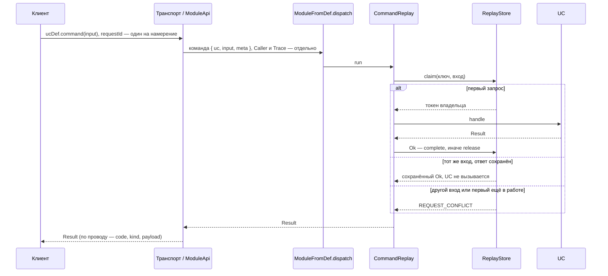

---
covers:
  - src/app/api-app/api-app.ts
  - src/app/client/**
  - src/app/replay/**
  - src/domain/contracts/command.ts
  - src/kernel/result/serialized-result.types.ts
---

# Как команда пересекает границу процесса

**Назначение:** почему один и тот же UC вызывается из бота, CLI, HTTP и другого сервиса без изменений, что теряется и восстанавливается на проводе и почему повтор запроса не исполняет операцию дважды. Читать перед работой с раннером, клиентом модуля или отсевом повторов.

---

## Схема

## Как это работает

1. **Одна форма для всех транспортов.** Команда — простые данные `{ uc, input, meta? }`, ответ — `Result`. В процессе объекты идут как есть, по проводу — тот же `Result` в JSON. Поэтому вынос модуля в сервис меняет подключение модуля к приложению, а не вызывающий код.
2. **Адрес — снаружи команды.** Модуль выбирает URL или Def модуля в `apiApp.dispatch`, а не поле команды: по адресу видно, куда идёт запрос, в логах и на прокси, и модуль можно увести за этот адрес в другой процесс.
3. **Кто вызывает — тоже снаружи.** Caller и `Trace` транспорт строит из своих данных (сессия бота, токен, заголовки) и передаёт рядом с командой: клиент не может вписать себе чужого субъекта в тело команды.
4. **Провод теряет тексты, Def их возвращает.** Ошибка уходит как `code`, `kind`, `payload`; `label` и `description` клиент берёт из того же Def UC. Код, которого нет в Def клиента, — ответ сервиса другой версии: клиент видит `SERVER_INTERNAL`, а не падает на неизвестном значении.
5. **Выход — только простые данные.** `Date` или `Map` после JSON становятся другим значением, а схема с преобразованиями второй раз не проходит; поэтому время — число, а клиент выход схемой не перепроверяет. Агрегат едет снапшотом, клиент собирает из него `ReadonlyAr` тем же доменным кодом: домен чистый и синхронный, он работает и на клиенте.
6. **Повтор безопасен.** Клиент повторяет запрос с тем же `requestId` при обрыве связи. `CommandReplay` занимает ключ (модуль, вызывающий, `requestId`) до исполнения UC: второй такой же запрос получает сохранённый ответ, а не вторую запись. Сохраняется только `Ok` — после отказа повтор исполнится заново, ведь данные не менялись.
7. **Сбой посреди запроса.** Если процесс упал после `claim`, запись остаётся «в работе» до TTL: повтор получает `in_progress`, а не второе исполнение — лучше переспросить, чем записать дважды. Поздний итог запроса, чья запись уже истекла и занята новым, токен владельца не пускает в чужую запись.

Как вызов идёт дальше внутри модуля — [путь вызова UC](./uc-path.md).

## Почему так

- Команда без имени модуля, адрес — у транспорта: вынос модуля в сервис предусмотрен (D-28), шва нет — `DEBT-5` (нет фасада к модулю в другом процессе); клиенты команду не меняют (D-49).
- Caller и `Trace` не входят в команду, их передаёт транспорт; между процессами — как JSON с восстановлением классов, внутри процесса — как есть (D-46, D-49).
- `requestId` — и след, и ключ идемпотентности: у намерения клиента один идентификатор, второго ключа клиенту не нужно помнить (D-56).
- Ожидаемая версия — поле входа, а не `meta`: она часть контракта UC и видна в `OPTIONS` (D-57).

## Где дальше

- Форма команды, HTTP, MCP, in-proc клиенты, таблица отсева — [reference/transport.md](../reference/transport.md).
- Кто вызывает и как строится след — [Caller и Trace](./caller.md).
