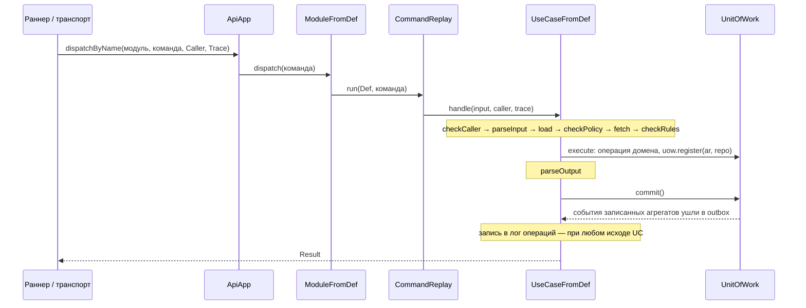

---
covers:
  - src/app/api-app/api-app.ts
  - src/app/module/**
  - src/app/replay/command-replay.ts
  - src/app/operation/**
  - src/app/use-case/**
---

# Путь вызова UC

**Назначение:** что происходит между «раннер получил запрос» и «клиент получил `Result`» — кто проверяет вход, право и версию, когда пишутся данные и когда уходят события. Читать перед первой реализацией UC и при правке конвейера в `dmg-core/app`.

---

## Схема

## Как это работает

1. **Адрес.** Раннер строит команду `{ uc, input }` и отдаёт её приложению с именем модуля. `ApiApp` находит модуль, модуль — реализацию UC по имени Def. Неизвестный модуль или UC — `OPERATION_NOT_FOUND`: это ответ клиенту другой версии, не исключение.
2. **Повтор.** Command UC, у которого клиент прислал `requestId`, а вызывающий — человек (пользователь, делегат, гость с посетителем канала), проходит через `CommandReplay`: тот же вход — сохранённый `Ok` без исполнения, другой вход или незавершённый первый запрос — `REQUEST_CONFLICT`. Запоминается только `Ok`: после `Err` или исключения повтор исполнится заново. Сбой хранилища повторов наружу не выходит: не удалось занять ключ — `SERVER_INTERNAL` без исполнения UC; не удалось сохранить ответ или снять запись — результат UC как есть, сбой — в логгер.
3. **До данных.** Вид вызывающего (`callers`), сужения для заместителя (`personal`, `readOnly`), схема входа, `load` (агрегаты для Policy), Policy, `fetch` (вызовы чужих модулей — только после права), доменные правила. Отказ здесь не меняет данных: UoW ещё не создана.
4. **Операция.** `execute` вызывает домен и регистрирует изменённые агрегаты в UoW; сверку ожидаемой версии от клиента делает первым шагом (`expectVersion`). Ошибка домена — `Err`, UoW не фиксируется.
5. **Фиксация.** Выход проверяется схемой до записи: невалидный ответ — баг реализации, и данные не меняются. Затем `commit` пишет агрегаты и отдаёт их события в outbox ([жизненный цикл агрегата](./aggregate-lifecycle.md)).
6. **След.** Запись в лог операций — последним шагом при любом исходе исполнения UC: записанные агрегаты (`writes`, версии до и после и патч полей `changes`, D-86), выход команды целиком, выход query — сводкой размера (D-73); поля `F.sensitive` во входе, выходе, ошибке и патче скрыты ([oplog.md](../reference/oplog.md)); отказы шагов 1–2 (адрес, повтор) UC не вызывают и в лог операций не попадают. Непредвиденное исключение становится `SERVER_INTERNAL`, детали — в логгер.

Образец: [assign-task.uc.ts](../../src/testing/example/backend/todo/task/uc/assign-task.uc.ts) — `load`, `fetch` через фасад `users`, `execute`.

## Почему так

- Модуль — единственная точка входа, команда — простые данные: вынос модуля в сервис предусмотрен (D-28): шов — прокси-фабрика, готового адаптера нет (`DEBT-5`); клиентский код не меняется (D-43, D-49).
- `fetch` после Policy: не-владелец не узнаёт ответ чужого модуля, а чужой модуль не получает лишний вызов (D-58).
- Сохранение и публикация — в базе, а не в UC: реализация не может забыть фиксацию или опубликовать события незаписанных агрегатов (D-15, D-47).
- Отсев повторов — на уровне модуля, до UC: повтор запроса не меняет данные второй раз (D-56).
- Ожидаемая версия — поле входа, сверяет UC: какой агрегат сверять, знает только он (D-57).

## Где дальше

- Написать UC — [guides/use-case.md](../guides/use-case.md); вызов из другого модуля — [guides/facade.md](../guides/facade.md).
- Коды ошибок ядра и `Result` — [errors-result.md](../reference/errors-result.md); кто вызывает — [caller.md](../reference/caller.md).
